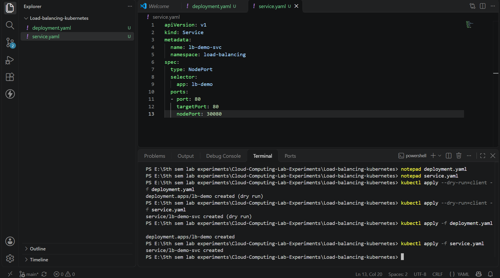
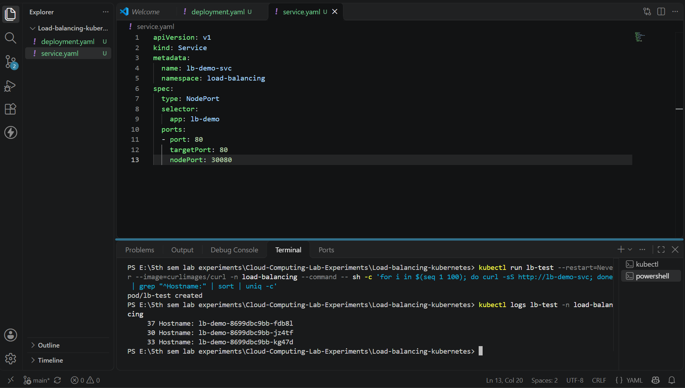
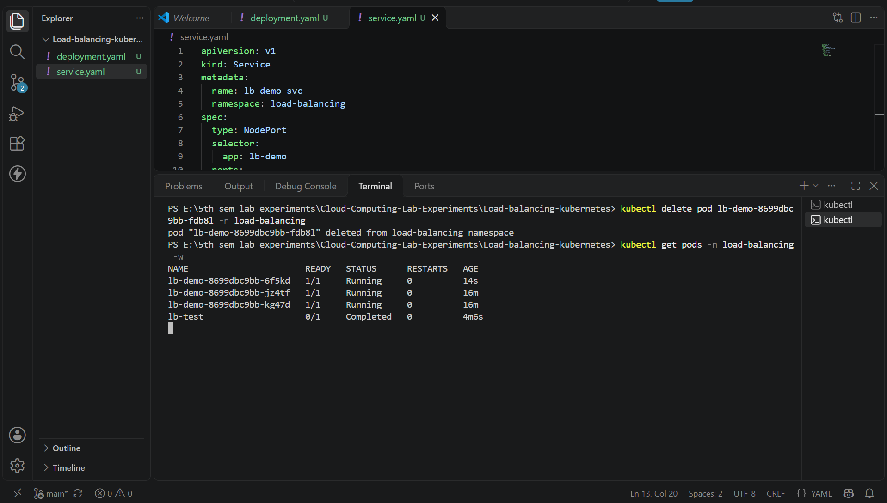
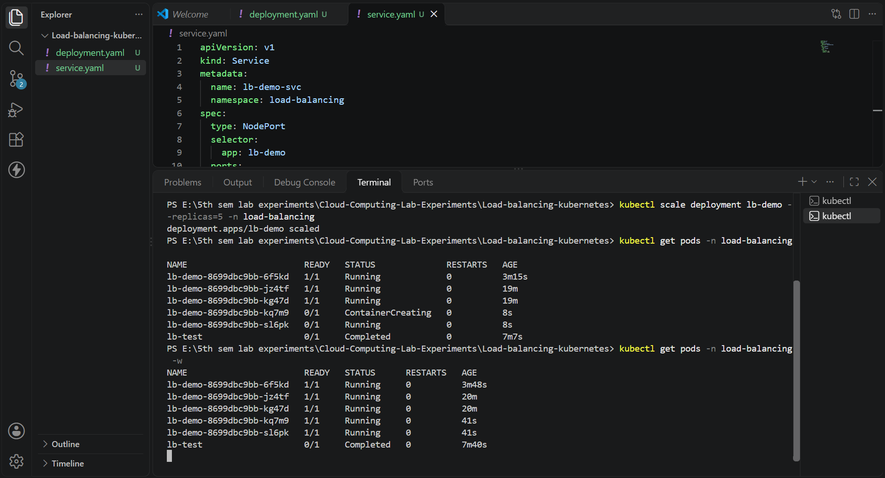

# Load Balancing Using Kubernetes Services

## 1. Project Overview

This project demonstrates **Load Balancing using Kubernetes Services**. It shows how Kubernetes distributes incoming HTTP requests across multiple application Pods, maintains application availability, and supports horizontal scaling.

The experiment is implemented using Docker Desktop Kubernetes and the `kubectl` command-line tool.

The project also demonstrates how Kubernetes automatically replaces a deleted Pod and maintains the desired number of replicas using a Deployment.

## 2. Objectives

1. Understand Kubernetes Deployments and Services.
2. Deploy multiple replicas of an application.
3. Distribute incoming HTTP requests across multiple Pods.
4. Verify load distribution using 100 HTTP requests.
5. Demonstrate automatic Pod replacement (self-healing).
6. Scale the application from 3 to 5 replicas.
7. Verify the application status after scaling.

## 3. Technologies Used

| Technology | Purpose |
|---|---|
| Kubernetes | Container orchestration |
| Docker Desktop | Local Kubernetes environment |
| kubectl | Kubernetes command-line management |
| YAML | Deployment and Service configuration |
| traefik/whoami | Sample web application |
| curlimages/curl | Sending HTTP requests for testing |
| PowerShell | Command execution environment |

## 4. System Architecture

The following architecture illustrates the complete Kubernetes load balancing setup, including the test client, Kubernetes Service, Deployment, application Pods, self-healing, and horizontal scaling.


### Architecture Explanation

1. **Load Test Client Pod:** Sends 100 HTTP requests to the Kubernetes Service using curl.
2. **Kubernetes Service:** The Service named `lb-demo-svc` receives requests on port 80 and routes them to available application Pod endpoints.
3. **Deployment:** The Deployment named `lb-demo` manages the application replicas through a ReplicaSet.
4. **Application Pods:** Multiple Pods run the `traefik/whoami` container and handle incoming requests.
5. **Self-Healing:** If a Pod is deleted, Kubernetes automatically creates a replacement.
6. **Horizontal Scaling:** The Deployment can increase or decrease the number of application replicas.

**Traffic Flow:**

Load Test Client Pod → Kubernetes Service → Available Application Pods

## 5. Project Structure

```text
Load-balancing-kubernetes/
│
├── deployment.yaml
├── service.yaml
├── README.md
├── Kubernetes Load Balancing Architecture.png
│
└── screenshots/
    ├── 01_YAML_Configuration_and_Validation.png
    ├── 02_Deployment_Service_and_Three_Ready_Pods.png
    ├── 03_100_Requests_Load_Balancing_Results.png
    ├── 04_Pod_Deletion_and_Automatic_Replacement.png
    ├── 05_Scaling_From_Three_To_Five_Replicas.png
    └── 06_Load_Balancing_After_Scaling_To_Five_Pods.png
```

## 6. Implementation

### Step 1: Create a Kubernetes Namespace

A separate namespace named `load-balancing` is created to isolate the resources used in this experiment.

```powershell
kubectl create namespace load-balancing
```

### Step 2: Create the Deployment

The `deployment.yaml` file defines the application and its replicas.

Configuration:
- Deployment name: `lb-demo`
- Initial replicas: 3
- Container image: `traefik/whoami`
- Container port: 80
- Readiness probe: HTTP GET on port 80

Apply the Deployment:

```powershell
kubectl apply -f deployment.yaml
```

Verify the Pods:

```powershell
kubectl get pods -n load-balancing
```

### Step 3: Create the Kubernetes Service

The `service.yaml` file exposes the application using a NodePort Service.

Configuration:

- Service name: `lb-demo-svc`
- Service type: NodePort
- Service port: 80
- Target port: 80
- NodePort: 30080
- Selector: `app: lb-demo`

Apply the Service:

```powershell
kubectl apply -f service.yaml
```

Verify the Service:

```powershell
kubectl get svc -n load-balancing
```

### Step 4: Verify Service Endpoints

Check the endpoints associated with the Service:

```powershell
kubectl get endpoints -n load-balancing
```

The Service discovers application Pods using the matching label selector.

### Step 5: Test Load Balancing with 100 Requests

A temporary client Pod is created inside the Kubernetes cluster using the `curlimages/curl` image.

The following command sends 100 HTTP requests to the Service and counts the responses received from each application Pod.

```powershell
kubectl run lb-test --restart=Never --image=curlimages/curl -n load-balancing --command -- sh -c 'for i in $(seq 1 100); do curl -sS http://lb-demo-svc; done | grep "^Hostname:" | sort | uniq -c'
```

View the results:

```powershell
kubectl logs lb-test -n load-balancing
```

**Observed Results — 3 Replicas**

| Application Pod | Requests Received |
|---|---:|
| Pod 1 | 37 |
| Pod 2 | 30 |
| Pod 3 | 33 |
| **Total** | **100** |

The results demonstrate that requests were distributed across all three application Pods.

### Step 6: Demonstrate Self-Healing

Delete one application Pod:

```powershell
kubectl delete pod <pod-name> -n load-balancing
```

Observe the Pods:

```powershell
kubectl get pods -n load-balancing -w
```

Kubernetes automatically creates a replacement Pod because the Deployment maintains the desired replica count.

This demonstrates the self-healing capability of Kubernetes.

### Step 7: Scale the Deployment from 3 to 5 Replicas

Increase the number of application replicas to five:

```powershell
kubectl scale deployment lb-demo --replicas=5 -n load-balancing
```

Verify the updated Deployment:

```powershell
kubectl get deployment -n load-balancing
```

Verify the Pods:

```powershell
kubectl get pods -n load-balancing
```

The Deployment successfully maintains five application Pods.

### Step 8: Test Load Balancing After Scaling

Send another 100 HTTP requests through the same Kubernetes Service.

```powershell
kubectl run lb-test --restart=Never --image=curlimages/curl -n load-balancing --command -- sh -c 'for i in $(seq 1 100); do curl -sS http://lb-demo-svc; done | grep "^Hostname:" | sort | uniq -c'
```

View the results:

```powershell
kubectl logs lb-test -n load-balancing
```

**Observed Results — 5 Replicas**

| Application Pod | Requests Received |
|---|---:|
| Pod 1 | 23 |
| Pod 2 | 30 |
| Pod 3 | 15 |
| Pod 4 | 20 |
| Pod 5 | 12 |
| **Total** | **100** |

All five Pods received requests, demonstrating load distribution after horizontal scaling.

*Note: Kubernetes Service load distribution is not guaranteed to follow strict round-robin scheduling. Therefore, request counts can vary between Pods.*

## 7. Screenshots and Execution Results

### 1. YAML Configuration and Validation



### 2. Deployment, Service and Three Ready Pods


### 3. Load Balancing with 100 Requests



### 4. Pod Deletion and Automatic Replacement



### 5. Scaling from Three to Five Replicas



### 6. Load Balancing After Scaling


## 8. Final Verification

The following command verifies the final Deployment, Pods, and Service:

```powershell
kubectl get all -n load-balancing
```

**Final Observations:**

- Deployment successfully maintained 5 replicas.
- All 5 application Pods reached the Running state.
- The Kubernetes Service exposed the application on port 80.
- NodePort 30080 was configured for external access.
- 100 HTTP requests were successfully tested through the Service from inside the cluster.
- Requests were distributed across all five application Pods.
- Automatic Pod replacement was successfully demonstrated.

## 9. Advantages

1. **Load Distribution:** Distributes incoming requests across multiple application Pods.
2. **High Availability:** Multiple replicas help keep the application available.
3. **Self-Healing:** Automatically replaces failed or deleted Pods.
4. **Scalability:** Supports increasing or decreasing the number of replicas.
5. **Resource Utilization:** Allows application workloads to be handled by multiple Pods.

## 10. Conclusion

This experiment successfully demonstrates Kubernetes load balancing using a NodePort Service and Deployment.

The application was initially deployed with three replicas, and 100 HTTP requests were distributed across the available Pods. The self-healing capability was verified by deleting a Pod and observing its automatic replacement.

The Deployment was then scaled from three to five replicas, and another 100-request test