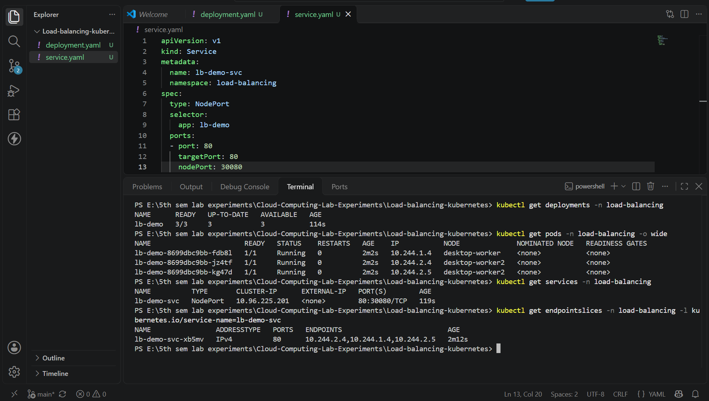
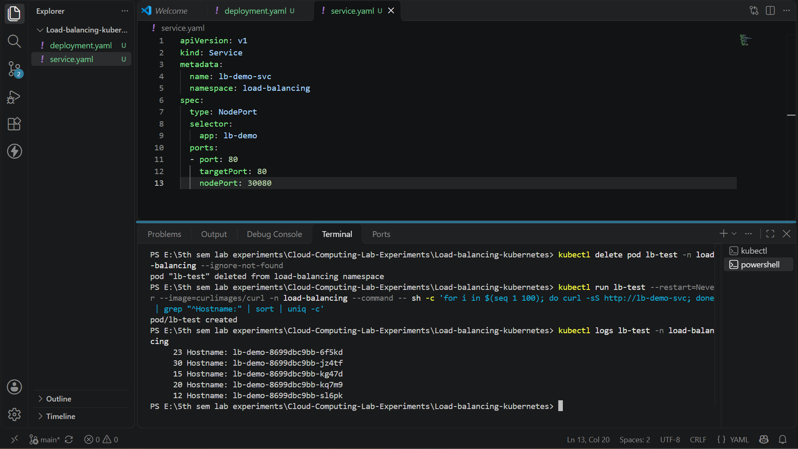
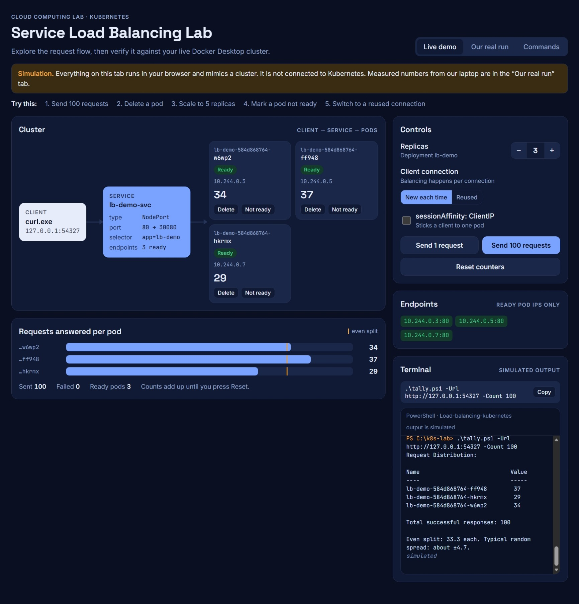

# Load Balancing Using Kubernetes Services

## 1. Project Overview

This experiment demonstrates load balancing in Kubernetes using a Deployment and a NodePort Service. Multiple replicas of a web application are deployed, and incoming HTTP requests are distributed across the available Pods by the Kubernetes Service.

The experiment also demonstrates Kubernetes self-healing by deleting a Pod and observing its automatic replacement, followed by scaling the Deployment from three replicas to five replicas.

An interactive web dashboard was additionally developed to visualize request distribution, monitor the actual Kubernetes cluster, perform load tests, and demonstrate scaling and Pod self-healing.

## 2. Objectives

1. Deploy a containerized web application on Kubernetes.
2. Create a Deployment with multiple replicas.
3. Expose the application using a NodePort Service.
4. Observe how a Kubernetes Service distributes requests across Pods.
5. Demonstrate automatic Pod replacement using a Deployment.
6. Scale the application from three replicas to five replicas.
7. Compare request distribution before and after scaling.
8. Develop an interactive dashboard to visualize and monitor Kubernetes load balancing.

## 3. Technologies Used

- Kubernetes
- Docker Desktop Kubernetes
- Docker
- kubectl
- YAML
- `traefik/whoami` container image
- Python
- HTML, CSS and JavaScript
- PowerShell

## 4. System Architecture

The following diagram shows the load-balancing setup used in this experiment. The load-test client sends requests to the Kubernetes Service, which forwards them to the available application Pods managed by the Deployment.


**Note:** The Service is configured as a NodePort Service on port `30080`. The request-distribution tests were performed from a temporary client Pod inside the cluster using the Service DNS name `lb-demo-svc`.

## 5. Project Structure

```text
Load-balancing-kubernetes/
│
├── app.py
├── dashboard.html
├── deployment.yaml
├── service.yaml
├── README.md
├── Kubernetes Load Balancing Architecture.png
│
└── screenshots/
    ├── 01_YAML_Configuration_and_Validation.png
    ├── 02_Deployment_Service_and_Three_Ready_Pods.png
    ├── 03_100_Requests_Load_Balancing_Results.png
    ├── 04_Pod_Deletion_and_Automatic_Replacement.png
    ├── 05_Scaling_From_Three_To_Five_Replicas.png
    ├── 06_Load_Balancing_After_Scaling_To_Five_Pods.png
    └── 07_Dashboard_Real_Kubernetes_Status.jpeg
```

## 6. Implementation

### Step 1: Create a Kubernetes Namespace

A separate namespace was created to keep the experiment resources isolated.

```powershell
kubectl create namespace load-balancing
kubectl get namespaces
```

### Step 2: Create the Deployment

The Deployment uses the `traefik/whoami` image and initially creates three replicas. Each Pod runs the application on port `80`.

Apply the Deployment:

```powershell
kubectl apply -f deployment.yaml -n load-balancing
```

Verify the Deployment and Pods:

```powershell
kubectl get deployments -n load-balancing
kubectl get pods -n load-balancing
```

### Step 3: Create the NodePort Service

The Service exposes the application on port `80` and is configured with NodePort `30080`. It selects the Pods created by the Deployment.

Apply the Service:

```powershell
kubectl apply -f service.yaml -n load-balancing
```

Verify the Service:

```powershell
kubectl get services -n load-balancing
```

### Step 4: Verify the Initial Deployment

The application was initially deployed with three replicas. The Deployment reported three available replicas, and all three Pods were in the Running state.

```powershell
kubectl get deployment,pods,svc -n load-balancing
```

### Step 5: Test Load Balancing with 100 Requests

A temporary client Pod using the `curlimages/curl` image was created inside the cluster. It sent 100 HTTP requests to the Kubernetes Service through its DNS name.

```powershell
kubectl run lb-test --restart=Never --image=curlimages/curl -n load-balancing --command -- sh -c 'for i in $(seq 1 100); do curl -sS http://lb-demo-svc; done | grep "^Hostname:" | sort | uniq -c'
```

The hostname in each response identifies the Pod that handled that request.

**Observed distribution across three Pods:**

| Pod | Requests handled |
|---|---:|
| Pod 1 | 37 |
| Pod 2 | 30 |
| Pod 3 | 33 |
| **Total** | **100** |

The requests were distributed across all three available Pods. The distribution was not exactly equal because Kubernetes Service load balancing does not guarantee strict round-robin distribution.

### Step 6: Demonstrate Self-Healing

One application Pod was deleted to demonstrate Kubernetes self-healing.

```powershell
kubectl get pods -n load-balancing
kubectl delete pod <pod-name> -n load-balancing
kubectl get pods -n load-balancing -w
```

The Deployment's ReplicaSet detected that the number of available Pods had fallen below the desired replica count and automatically created a replacement Pod.

After the replacement became ready, the application again had three running replicas.

### Step 7: Scale the Deployment to Five Replicas

The Deployment was scaled from three replicas to five replicas.

```powershell
kubectl scale deployment lb-demo --replicas=5 -n load-balancing
kubectl get pods -n load-balancing
kubectl get deployment lb-demo -n load-balancing
```

Kubernetes created two additional Pods. The Deployment reached five available replicas.

### Step 8: Test Load Balancing After Scaling

The client Pod sent another 100 HTTP requests to the same Kubernetes Service.

```powershell
kubectl run lb-test --restart=Never --image=curlimages/curl -n load-balancing --command -- sh -c 'for i in $(seq 1 100); do curl -sS http://lb-demo-svc; done | grep "^Hostname:" | sort | uniq -c'
```

**Observed distribution across five Pods:**

| Pod | Requests handled |
|---|---:|
| Pod 1 | 23 |
| Pod 2 | 30 |
| Pod 3 | 15 |
| Pod 4 | 20 |
| Pod 5 | 12 |
| **Total** | **100** |

After scaling, requests were distributed across all five Pods. The counts were uneven, which is expected because Kubernetes Service routing does not promise an exact equal or round-robin split.

## 7. Screenshots

### 7.1 YAML Configuration and Validation


### 7.2 Deployment, Service, and Three Ready Pods



### 7.3 Load Balancing Results for 100 Requests Across Three Pods


### 7.4 Pod Deletion and Automatic Replacement


### 7.5 Scaling from Three to Five Replicas


### 7.6 Load Balancing Results After Scaling to Five Pods



## 8. Interactive Kubernetes Load Balancing Dashboard

An interactive web dashboard was developed using Python, HTML, CSS, and JavaScript to make the experiment easier to visualize and demonstrate.

The dashboard contains three main sections:

### 8.1 Live Demo

- Visualizes the flow of requests from the client to the Kubernetes Service and application Pods.
- Displays request counts handled by individual Pods.
- Simulates request distribution and load balancing.
- Demonstrates Pod deletion, readiness changes, and scaling.
- Provides controls to send requests and observe distribution.

### 8.2 Our Real Run

This section connects to the actual Kubernetes cluster running through Docker Desktop.

Features include:

- Displays the current Deployment replica status.
- Shows the actual running Pods and their readiness.
- Displays Pod IP addresses, node names, and restart counts.
- Shows the available Service endpoints.
- Executes 100 real HTTP requests through the Kubernetes Service and displays the resulting Pod distribution.
- Allows the Deployment to be scaled through the dashboard.
- Demonstrates Pod deletion and automatic replacement.

### 8.3 Commands

Displays the PowerShell commands used to manage and verify the Kubernetes deployment.

**Important:** The Live Demo section is an interactive simulation. The Our Real Run section communicates with the actual Kubernetes cluster and performs real cluster operations.

### 8.4 Running the Dashboard

Make sure Docker Desktop Kubernetes is running and the application resources are available.

Open PowerShell in the project directory and execute:

```powershell
python app.py
```

The dashboard server starts at:

```text
http://127.0.0.1:8000
```

Open the URL in a web browser to access the dashboard.

The Python application provides the backend API, while `dashboard.html` provides the interactive frontend.

### 8.5 Dashboard Screenshot



## 9. Final Verification

The final state of the experiment was verified using:

```powershell
kubectl get deployment,pods,services -n load-balancing
```

The final Deployment had five available replicas, all five application Pods were Running and Ready, and the NodePort Service was available.

The dashboard was also tested against the running Kubernetes cluster to display the actual Pod and Service information.

## 10. Advantages of Kubernetes Load Balancing

- **High availability:** Requests can be served by multiple application Pods.
- **Scalability:** The number of replicas can be increased or decreased based on application requirements.
- **Self-healing:** The Deployment automatically replaces failed or deleted Pods to maintain the desired replica count.
- **Service discovery:** Pods can be accessed through a stable Kubernetes Service name.
- **Better resource utilization:** Incoming requests can be handled by multiple application instances.
- **Monitoring and visualization:** The dashboard makes it easier to observe Pod status and request distribution.

## 11. Conclusion

This experiment successfully demonstrated Kubernetes load balancing using a NodePort Service and Deployment. Initially, the application was deployed with three replicas, and 100 HTTP requests were distributed across the three Pods. When one Pod was deleted, Kubernetes automatically created a replacement, demonstrating self-healing.

The Deployment was then scaled from three replicas to five replicas. A second set of 100 requests was distributed across the five Pods. An interactive web dashboard was also developed to visualize request distribution, monitor the actual Kubernetes cluster, and demonstrate scaling and self-healing operations.

The experiment shows how Kubernetes Services provide a stable access point for applications, while Deployments help maintain the desired number of replicas and support scaling.

## 12. Author Details

- **Name:** Shreenidhi Dharwad
- **Department:** Computer Science and Engineering (AI)
- **Semester:** 5th Semester
- **Subject:** Cloud Computing